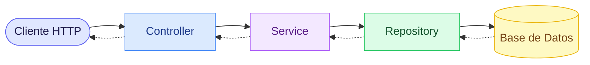
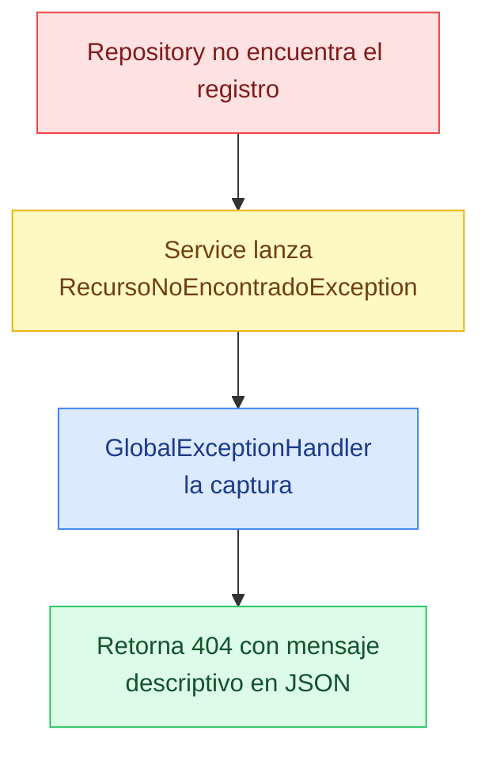
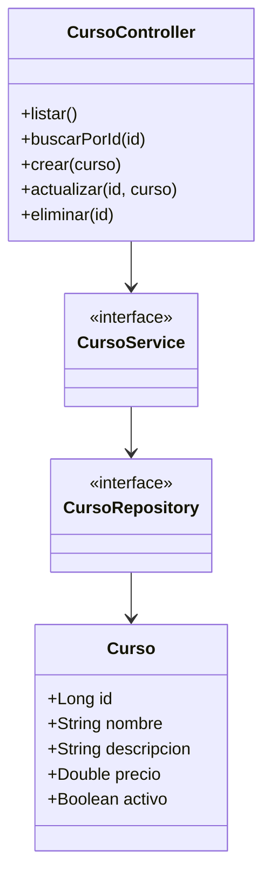
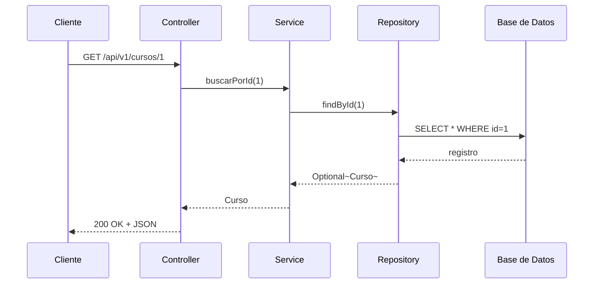

<div class="absolute inset-0 bg-gradient-to-b from-black/60 via-black/40 to-black/70" />

<div class="relative z-10 flex flex-col items-center justify-center h-full">

<div class="mb-4 px-4 py-1 rounded-full border border-blue-300/80 text-blue-100 text-sm tracking-widest uppercase font-semibold bg-blue-600/40">
  Spring Boot · JPA · REST · Postman
</div>

# CRUD con Spring Boot y JPA

<div class="text-xl text-gray-100 font-light mt-3 tracking-wide">
  Construye una API REST completa desde cero
</div>

<div class="mt-6 flex justify-center gap-3 flex-wrap">
  <button @click="$slidev.nav.go(2)" class="px-5 py-2 rounded-full border border-white/40 bg-white/10 text-white text-sm font-medium hover:bg-white/20 transition-colors cursor-pointer">
    📋 Ver Temario
  </button>
  <button @click="$slidev.nav.go(8)" class="px-5 py-2 rounded-full border border-teal-300/60 bg-teal-500/20 text-teal-100 text-sm font-medium hover:bg-teal-500/30 transition-colors cursor-pointer">
    🧭 Rutas de Aprendizaje
  </button>
  <button @click="$slidev.nav.go(45)" class="px-5 py-2 rounded-full border border-blue-300/60 bg-blue-500/20 text-blue-100 text-sm font-medium hover:bg-blue-500/30 transition-colors cursor-pointer">
    📖 Ver Contenido
  </button>
</div>


</div>

---
src: ./pages/temario.md
---

---
src: ./pages/rutas-selector.md
---

---
src: ./pages/rutas-aprendizaje.md
---

---
src: ./pages/rutas-backend.md
---

---
src: ./pages/rutas-frontend.md
---

---
src: ./pages/rutas-ciberseguridad.md
---

---
src: ./pages/rutas-qa.md
---

---
transition: fade
layout: default
---

# Contenido del Curso

<div class="grid grid-cols-2 gap-4 mt-4">

<div class="p-4 rounded-xl border border-blue-200 bg-blue-50">
  <div class="text-blue-600 font-bold mb-2">🤖 IA & Herramientas</div>
  <ul class="text-sm text-gray-600 space-y-1">
    <li>Vibe Coding</li>
    <li>IDEs con IA integrada</li>
    <li>Kiro IDE</li>
    <li>Prompt Engineering</li>
  </ul>
</div>

<div class="p-4 rounded-xl border border-green-200 bg-green-50">
  <div class="text-green-600 font-bold mb-2">☕ Spring Boot</div>
  <ul class="text-sm text-gray-600 space-y-1">
    <li>IoC e Inyección de Dependencias</li>
    <li>Arquitectura en Capas</li>
    <li>JPA e Hibernate</li>
    <li>Lombok & Repository</li>
  </ul>
</div>

<div class="p-4 rounded-xl border border-purple-200 bg-purple-50">
  <div class="text-purple-600 font-bold mb-2">🌐 API REST</div>
  <ul class="text-sm text-gray-600 space-y-1">
    <li>Verbos HTTP & Códigos de respuesta</li>
    <li>Estándares de diseño REST</li>
    <li>Controller, Service, Repository</li>
    <li>Validaciones & Excepciones</li>
  </ul>
</div>

<div class="p-4 rounded-xl border border-orange-200 bg-orange-50">
  <div class="text-orange-600 font-bold mb-2">🧪 Práctica</div>
  <ul class="text-sm text-gray-600 space-y-1">
    <li>Construcción del CRUD completo</li>
    <li>Pruebas con Postman</li>
    <li>Manejo global de excepciones</li>
  </ul>
</div>

</div>

---
layout: section
background: https://images.unsplash.com/photo-1555066931-4365d14bab8c?auto=format&fit=crop&w=1920&q=40
---

<div class="text-blue-300 text-sm tracking-widest uppercase font-semibold mb-2">Sección 01</div>

# IA & Vibe Coding

<div class="text-gray-200 mt-2">El nuevo paradigma del desarrollo de software</div>

---
transition: slide-up
---

# ¿Qué es Vibe Coding?

<div class="grid grid-cols-2 gap-8 mt-2">
<div>

**Vibe Coding** es una forma de programar donde el desarrollador describe en lenguaje natural lo que quiere construir y una IA genera el código automáticamente.

El término fue acuñado por **Andrej Karpathy** en 2025 y describe el cambio de paradigma donde el foco pasa de escribir código a **dirigir, revisar y validar** lo que la IA produce.

</div>
<div class="flex items-center justify-center">

<div class="p-6 rounded-2xl border border-blue-300 bg-blue-50 text-center shadow-sm">
  <div class="text-5xl mb-3">🧠</div>
  <div class="text-blue-700 font-semibold text-sm">"Tú eres el arquitecto,</div>
  <div class="text-blue-700 font-semibold text-sm">la IA es el constructor."</div>
</div>

</div>
</div>

---
transition: slide-up
---

# Vibe Coding — ¿Cómo funciona?

<div class="mt-4 space-y-3">

<v-clicks>

<div class="flex items-center gap-4 p-3 rounded-xl border border-gray-200 bg-gray-50 shadow-sm">
  <div class="text-2xl w-10 text-center">🧠</div>
  <div><span class="text-blue-600 font-bold">Describes</span> lo que necesitas en lenguaje natural</div>
</div>

<div class="flex items-center gap-4 p-3 rounded-xl border border-gray-200 bg-gray-50 shadow-sm">
  <div class="text-2xl w-10 text-center">🤖</div>
  <div><span class="text-green-600 font-bold">La IA genera</span> el código, los archivos o la estructura</div>
</div>

<div class="flex items-center gap-4 p-3 rounded-xl border border-gray-200 bg-gray-50 shadow-sm">
  <div class="text-2xl w-10 text-center">👀</div>
  <div><span class="text-yellow-600 font-bold">Revisas</span> el resultado y validas que sea correcto</div>
</div>

<div class="flex items-center gap-4 p-3 rounded-xl border border-gray-200 bg-gray-50 shadow-sm">
  <div class="text-2xl w-10 text-center">🔁</div>
  <div><span class="text-orange-600 font-bold">Iteras</span> con más instrucciones si algo no está bien</div>
</div>

<div class="flex items-center gap-4 p-3 rounded-xl border border-gray-200 bg-gray-50 shadow-sm">
  <div class="text-2xl w-10 text-center">✅</div>
  <div><span class="text-emerald-600 font-bold">Apruebas</span> y el código queda integrado al proyecto</div>
</div>

</v-clicks>

</div>

---
layout: two-cols
layoutClass: gap-12
transition: slide-up
---

# Vibe Coding — Ventajas

<div class="mt-4">

| Ventaja | Descripción |
|---------|-------------|
| ⚡ **Velocidad** | Genera código en segundos |
| 🎯 **Foco** | Concentración en arquitectura |
| 📚 **Aprendizaje** | Ver código generado enseña |
| 🔁 **Iteración** | Probar ideas sin costo alto |

</div>

::right::

# Consideraciones

<div class="mt-4 space-y-4">

<div class="p-3 rounded-lg border border-yellow-300 bg-yellow-50 text-sm text-gray-700 shadow-sm">
  ⚠️ No reemplaza <strong>entender el código</strong> — debes poder revisarlo y corregirlo
</div>

<div class="p-3 rounded-lg border border-yellow-300 bg-yellow-50 text-sm text-gray-700 shadow-sm">
  ⚠️ La calidad del resultado depende de la <strong>calidad de la instrucción</strong>
</div>

<div class="p-3 rounded-lg border border-yellow-300 bg-yellow-50 text-sm text-gray-700 shadow-sm">
  ⚠️ Siempre validar <strong>seguridad, rendimiento y buenas prácticas</strong>
</div>

</div>

---
transition: slide-up
---

# IDEs con IA Integrada

<div class="mt-4">

| IDE | IA integrada | Característica destacada |
|-----|-------------|--------------------------|
| **Kiro** | IA agéntica propia | Spec, steering, hooks, agentes autónomos |
| **Cursor** | GPT-4 / Claude | Chat con el codebase completo |
| **GitHub Copilot** | OpenAI Codex | Autocompletado en tiempo real |
| **IntelliJ IDEA** | AI Assistant | Integración nativa con JetBrains |
| **VS Code** | Copilot / extensiones | Amplio ecosistema de extensiones IA |

</div>

---
layout: two-cols
layoutClass: gap-12
transition: slide-up
---

# Kiro IDE

**Kiro** es un IDE agéntico construido sobre VS Code que va más allá del autocompletado: puede planear, diseñar e implementar funcionalidades completas de forma autónoma.

<div class="mt-4 p-4 rounded-xl border border-blue-300 bg-blue-50 text-sm text-blue-700 shadow-sm">
  💡 Kiro es el IDE que estamos usando ahora mismo para construir estas slides.
</div>

::right::

<div class="mt-4 space-y-3">

<div class="p-3 rounded-lg border border-gray-200 bg-gray-50 shadow-sm">
  <span class="text-blue-600 font-bold">Spec</span><br>
  <span class="text-sm text-gray-600">Requisitos → diseño → tareas → implementación</span>
</div>
<div class="p-3 rounded-lg border border-gray-200 bg-gray-50 shadow-sm">
  <span class="text-green-600 font-bold">Steering</span><br>
  <span class="text-sm text-gray-600">Archivos .md con contexto y reglas permanentes</span>
</div>
<div class="p-3 rounded-lg border border-gray-200 bg-gray-50 shadow-sm">
  <span class="text-purple-600 font-bold">Hooks</span><br>
  <span class="text-sm text-gray-600">Automatizaciones en eventos del IDE</span>
</div>
<div class="p-3 rounded-lg border border-gray-200 bg-gray-50 shadow-sm">
  <span class="text-orange-600 font-bold">Autopilot / Supervised</span><br>
  <span class="text-sm text-gray-600">Control total sobre la autonomía del agente</span>
</div>

</div>

---
layout: section
background: https://images.unsplash.com/photo-1555066931-4365d14bab8c?auto=format&fit=crop&w=1920&q=40
---

<div class="text-purple-300 text-sm tracking-widest uppercase font-semibold mb-2">Sección 02</div>

# Prompt Engineering

<div class="text-gray-200 mt-2">Cómo hablarle bien a la IA para obtener resultados precisos</div>

---
transition: slide-up
---

# ¿Qué es Prompt Engineering?

<div class="grid grid-cols-2 gap-8 mt-2">
<div>

**Prompt Engineering** es la práctica de diseñar y redactar instrucciones claras y efectivas para obtener los mejores resultados de un modelo de IA.

<div class="mt-6 p-4 rounded-xl border border-purple-300 bg-purple-50 shadow-sm">
  <div class="text-purple-700 text-sm italic">"La calidad del output de la IA es directamente proporcional a la calidad del input que le das."</div>
</div>

</div>
<div>

<div class="space-y-3 mt-2">

<v-clicks>

<div class="flex gap-3 items-start p-3 rounded-lg border border-gray-200 bg-gray-50 text-sm shadow-sm">
  <span class="text-xl">🎯</span> <div><strong class="text-blue-600">Contexto</strong> — info sobre proyecto y tecnología</div>
</div>
<div class="flex gap-3 items-start p-3 rounded-lg border border-gray-200 bg-gray-50 text-sm shadow-sm">
  <span class="text-xl">📋</span> <div><strong class="text-green-600">Rol</strong> — cómo debe comportarse la IA</div>
</div>
<div class="flex gap-3 items-start p-3 rounded-lg border border-gray-200 bg-gray-50 text-sm shadow-sm">
  <span class="text-xl">🔍</span> <div><strong class="text-yellow-600">Especificidad</strong> — concreto, sin ambigüedades</div>
</div>
<div class="flex gap-3 items-start p-3 rounded-lg border border-gray-200 bg-gray-50 text-sm shadow-sm">
  <span class="text-xl">📐</span> <div><strong class="text-orange-600">Formato</strong> — lista, tabla, código, explicación</div>
</div>
<div class="flex gap-3 items-start p-3 rounded-lg border border-gray-200 bg-gray-50 text-sm shadow-sm">
  <span class="text-xl">🔁</span> <div><strong class="text-purple-600">Iteración</strong> — refinar si el resultado no es el esperado</div>
</div>

</v-clicks>

</div>
</div>
</div>

---
layout: two-cols
layoutClass: gap-12
transition: slide-up
---

# Prompt débil ❌

<div class="mt-4 p-4 rounded-xl border border-red-200 bg-red-50 font-mono text-sm text-red-700 shadow-sm">
  "Hazme un CRUD en Java"
</div>

<div class="mt-4 text-sm text-gray-500">
  No especifica tecnología, versión, entidad, arquitectura ni requisitos. El resultado será genérico e incompleto.
</div>

::right::

# Prompt efectivo ✅

<div class="mt-4 p-4 rounded-xl border border-green-200 bg-green-50 font-mono text-xs text-green-700 leading-relaxed shadow-sm">
  "Crea un CRUD REST con Spring Boot 3.2 y JPA para la entidad Curso con los campos: id, nombre, descripcion, precio y activo. Usa la arquitectura Controller-Service-Repository. Incluye manejo de excepciones con @RestControllerAdvice y validaciones con @Valid. La base de datos es MySQL."
</div>

<div class="mt-3 text-xs text-gray-500">
  ✅ tecnología · versión · entidad · campos · arquitectura · requisitos
</div>

---
transition: slide-up
---

# Tipos de Prompts en Desarrollo

<div class="grid grid-cols-2 gap-3 mt-4">

<div class="p-3 rounded-xl border border-blue-200 bg-blue-50 shadow-sm">
  <div class="text-blue-600 font-bold text-sm mb-1">⚡ Generación</div>
  <div class="text-xs text-gray-600">"Crea una clase Java que represente un Curso con JPA"</div>
</div>

<div class="p-3 rounded-xl border border-green-200 bg-green-50 shadow-sm">
  <div class="text-green-600 font-bold text-sm mb-1">📖 Explicación</div>
  <div class="text-xs text-gray-600">"Explícame qué hace la anotación @Transactional"</div>
</div>

<div class="p-3 rounded-xl border border-purple-200 bg-purple-50 shadow-sm">
  <div class="text-purple-600 font-bold text-sm mb-1">🔧 Refactoring</div>
  <div class="text-xs text-gray-600">"Refactoriza este Service para aplicar responsabilidad única"</div>
</div>

<div class="p-3 rounded-xl border border-red-200 bg-red-50 shadow-sm">
  <div class="text-red-600 font-bold text-sm mb-1">🐛 Depuración</div>
  <div class="text-xs text-gray-600">"Tengo este error al arrancar Spring Boot, ¿cuál es la causa?"</div>
</div>

<div class="p-3 rounded-xl border border-yellow-200 bg-yellow-50 shadow-sm">
  <div class="text-yellow-600 font-bold text-sm mb-1">✏️ Completado</div>
  <div class="text-xs text-gray-600">"Completa los métodos que faltan en este Repository"</div>
</div>

<div class="p-3 rounded-xl border border-orange-200 bg-orange-50 shadow-sm">
  <div class="text-orange-600 font-bold text-sm mb-1">🔍 Revisión</div>
  <div class="text-xs text-gray-600">"Revisa este código y sugiere mejoras de seguridad"</div>
</div>

</div>

---
layout: section
background: https://images.unsplash.com/photo-1555066931-4365d14bab8c?auto=format&fit=crop&w=1920&q=40
---

<div class="text-green-300 text-sm tracking-widest uppercase font-semibold mb-2">Sección 03</div>

# Spring Boot

<div class="text-gray-200 mt-2">Framework, IoC, Inyección de Dependencias y Arquitectura en Capas</div>

---
transition: slide-up
---

# ¿Qué es Spring Boot?

<div class="grid grid-cols-2 gap-8 mt-2">
<div>

Spring Boot es un framework basado en Spring que permite crear aplicaciones Java de forma rápida, con configuración mínima.

<div class="mt-4 space-y-3">
<v-clicks>

<div class="flex gap-3 items-center p-3 rounded-lg border border-gray-200 bg-gray-50 text-sm shadow-sm">
  <span class="text-xl">🚀</span> <div><strong class="text-green-600">Autoconfiguración</strong> — detecta y configura automáticamente</div>
</div>
<div class="flex gap-3 items-center p-3 rounded-lg border border-gray-200 bg-gray-50 text-sm shadow-sm">
  <span class="text-xl">📦</span> <div><strong class="text-blue-600">Servidor embebido</strong> — Tomcat incluido, sin deploy externo</div>
</div>
<div class="flex gap-3 items-center p-3 rounded-lg border border-gray-200 bg-gray-50 text-sm shadow-sm">
  <span class="text-xl">🔧</span> <div><strong class="text-purple-600">Sin XML</strong> — configuración por anotaciones</div>
</div>
<div class="flex gap-3 items-center p-3 rounded-lg border border-gray-200 bg-gray-50 text-sm shadow-sm">
  <span class="text-xl">⚡</span> <div><strong class="text-yellow-600">Arranque rápido</strong> — proyecto funcional en minutos</div>
</div>

</v-clicks>
</div>

</div>
<div class="flex items-center justify-center">
  <div class="p-8 rounded-2xl border border-green-200 bg-green-50 text-center shadow-sm">
    <div class="flex justify-center mb-4"><logos-spring-icon class="text-6xl" /></div>
    <div class="text-green-700 font-bold">Spring Boot</div>
    <div class="text-gray-500 text-sm mt-1">v3.x · Java 17+</div>
  </div>
</div>
</div>

---
layout: two-cols
layoutClass: gap-12
transition: slide-up
---

# Inversión de Control (IoC)

Spring gestiona la creación y el ciclo de vida de los objetos. El desarrollador no instancia clases manualmente.

<div class="mt-4 p-3 rounded-lg border border-blue-200 bg-blue-50 text-sm text-blue-700 shadow-sm">
  En lugar de <code>new MiServicio()</code>, Spring crea y entrega el objeto automáticamente.
</div>

<div class="mt-6">

# Inyección de Dependencias (DI)

Spring inyecta automáticamente las dependencias que un objeto necesita.

</div>

::right::

<div class="mt-4 space-y-2">
<div class="text-sm font-bold text-gray-700 mb-3">Anotaciones esenciales</div>

<div class="p-2 rounded-lg border border-gray-200 bg-gray-50 text-xs shadow-sm">
  <code class="text-green-600">@SpringBootApplication</code><br>
  <span class="text-gray-500">Clase principal, activa toda la configuración</span>
</div>
<div class="p-2 rounded-lg border border-gray-200 bg-gray-50 text-xs shadow-sm">
  <code class="text-blue-600">@Component</code><br>
  <span class="text-gray-500">Marca una clase como componente de Spring</span>
</div>
<div class="p-2 rounded-lg border border-gray-200 bg-gray-50 text-xs shadow-sm">
  <code class="text-purple-600">@Service</code><br>
  <span class="text-gray-500">Componente de la capa de lógica de negocio</span>
</div>
<div class="p-2 rounded-lg border border-gray-200 bg-gray-50 text-xs shadow-sm">
  <code class="text-yellow-600">@Repository</code><br>
  <span class="text-gray-500">Componente de la capa de acceso a datos</span>
</div>
<div class="p-2 rounded-lg border border-gray-200 bg-gray-50 text-xs shadow-sm">
  <code class="text-orange-600">@Autowired</code><br>
  <span class="text-gray-500">Inyecta una dependencia automáticamente</span>
</div>

</div>

---
transition: slide-up
---

# Arquitectura en Capas

<div class="grid grid-cols-4 gap-3 mt-6">

<div class="p-4 rounded-xl border border-blue-200 bg-blue-50 text-center shadow-sm">
  <div class="text-2xl mb-2">🌐</div>
  <div class="text-blue-600 font-bold text-sm">Controller</div>
  <div class="text-xs text-gray-500 mt-1">Recibe la petición HTTP y retorna la respuesta</div>
</div>

<div class="p-4 rounded-xl border border-purple-200 bg-purple-50 text-center shadow-sm">
  <div class="text-2xl mb-2">⚙️</div>
  <div class="text-purple-600 font-bold text-sm">Service</div>
  <div class="text-xs text-gray-500 mt-1">Aplica la lógica de negocio</div>
</div>

<div class="p-4 rounded-xl border border-green-200 bg-green-50 text-center shadow-sm">
  <div class="text-2xl mb-2">🗄️</div>
  <div class="text-green-600 font-bold text-sm">Repository</div>
  <div class="text-xs text-gray-500 mt-1">Accede y persiste datos en la BD</div>
</div>

<div class="p-4 rounded-xl border border-yellow-200 bg-yellow-50 text-center shadow-sm">
  <div class="text-2xl mb-2">📋</div>
  <div class="text-yellow-600 font-bold text-sm">Model</div>
  <div class="text-xs text-gray-500 mt-1">Representa la entidad / tabla de la BD</div>
</div>

</div>

<div class="flex justify-center mt-6">



</div>

<div class="mt-3 text-xs text-gray-400 text-center">
  Cada capa tiene una responsabilidad única y solo se comunica con la capa adyacente
</div>

---
layout: section
background: https://images.unsplash.com/photo-1555066931-4365d14bab8c?auto=format&fit=crop&w=1920&q=40
---

<div class="text-orange-300 text-sm tracking-widest uppercase font-semibold mb-2">Sección 04</div>

# API REST

<div class="text-gray-200 mt-2">Principios, verbos HTTP, códigos de respuesta y estándares de diseño</div>

---
transition: slide-up
---

# ¿Qué es una API REST?

<div class="grid grid-cols-2 gap-8 mt-2">
<div>

**REST** (Representational State Transfer) es un estilo de arquitectura para diseñar servicios web basado en HTTP.

<div class="mt-4 space-y-3">
<v-clicks>

<div class="flex gap-3 items-center p-3 rounded-lg border border-gray-200 bg-gray-50 text-sm shadow-sm">
  <span>🔗</span> <div><strong class="text-blue-600">Recursos identificables</strong> — cada entidad tiene su URL</div>
</div>
<div class="flex gap-3 items-center p-3 rounded-lg border border-gray-200 bg-gray-50 text-sm shadow-sm">
  <span>🚫</span> <div><strong class="text-red-600">Sin estado (stateless)</strong> — cada petición es independiente</div>
</div>
<div class="flex gap-3 items-center p-3 rounded-lg border border-gray-200 bg-gray-50 text-sm shadow-sm">
  <span>📦</span> <div><strong class="text-green-600">Formato estándar</strong> — respuestas en JSON</div>
</div>
<div class="flex gap-3 items-center p-3 rounded-lg border border-gray-200 bg-gray-50 text-sm shadow-sm">
  <span>🏷️</span> <div><strong class="text-yellow-600">Versionar la API</strong> — <code>/api/v1/</code> para compatibilidad futura</div>
</div>

</v-clicks>
</div>

</div>
<div class="flex items-center justify-center">
  <div class="p-6 rounded-2xl border border-orange-200 bg-orange-50 text-center font-mono text-sm space-y-2 shadow-sm">
    <div class="text-gray-400">GET</div>
    <div class="text-green-600">/api/v1/cursos</div>
    <div class="text-gray-400 mt-2">POST</div>
    <div class="text-blue-600">/api/v1/cursos</div>
    <div class="text-gray-400 mt-2">DELETE</div>
    <div class="text-red-600">/api/v1/cursos/1</div>
  </div>
</div>
</div>

---
layout: two-cols
layoutClass: gap-12
transition: slide-up
---

# Verbos HTTP

<div class="mt-4 space-y-2">

<div class="flex items-center gap-3 p-3 rounded-lg border border-green-200 bg-green-50 text-sm shadow-sm">
  <code class="text-green-700 font-bold w-16">GET</code>
  <span class="text-gray-600">Obtener datos</span>
  <span class="ml-auto text-xs text-gray-400">❌ No modifica</span>
</div>
<div class="flex items-center gap-3 p-3 rounded-lg border border-blue-200 bg-blue-50 text-sm shadow-sm">
  <code class="text-blue-700 font-bold w-16">POST</code>
  <span class="text-gray-600">Crear recurso</span>
  <span class="ml-auto text-xs text-gray-400">✅ Modifica</span>
</div>
<div class="flex items-center gap-3 p-3 rounded-lg border border-yellow-200 bg-yellow-50 text-sm shadow-sm">
  <code class="text-yellow-700 font-bold w-16">PUT</code>
  <span class="text-gray-600">Actualizar completo</span>
  <span class="ml-auto text-xs text-gray-400">✅ Modifica</span>
</div>
<div class="flex items-center gap-3 p-3 rounded-lg border border-orange-200 bg-orange-50 text-sm shadow-sm">
  <code class="text-orange-700 font-bold w-16">PATCH</code>
  <span class="text-gray-600">Actualizar parcial</span>
  <span class="ml-auto text-xs text-gray-400">✅ Modifica</span>
</div>
<div class="flex items-center gap-3 p-3 rounded-lg border border-red-200 bg-red-50 text-sm shadow-sm">
  <code class="text-red-700 font-bold w-16">DELETE</code>
  <span class="text-gray-600">Eliminar recurso</span>
  <span class="ml-auto text-xs text-gray-400">✅ Modifica</span>
</div>

</div>

::right::

# PUT vs PATCH

<div class="mt-4 space-y-4">

<div class="p-4 rounded-xl border border-yellow-200 bg-yellow-50 shadow-sm">
  <div class="text-yellow-700 font-bold text-sm mb-2">PUT — Reemplaza todo</div>
  <div class="font-mono text-xs text-gray-600">PUT /api/v1/cursos/1<br>→ nombre, descripcion, precio, activo</div>
  <div class="text-xs text-gray-400 mt-2">Si omites un campo, ese campo se pierde</div>
</div>

<div class="p-4 rounded-xl border border-orange-200 bg-orange-50 shadow-sm">
  <div class="text-orange-700 font-bold text-sm mb-2">PATCH — Actualiza solo lo que cambia</div>
  <div class="font-mono text-xs text-gray-600">PATCH /api/v1/cursos/1<br>→ solo: precio</div>
  <div class="text-xs text-gray-400 mt-2">El resto de los campos se mantienen intactos</div>
</div>

</div>

---
transition: slide-up
---

# Estándares de Diseño REST

<div class="grid grid-cols-2 gap-4 mt-4">

<div class="space-y-2">
<div class="text-green-600 font-bold text-sm mb-3">✅ Correcto</div>

<div class="p-2 rounded-lg bg-green-50 border border-green-200 font-mono text-sm text-green-700 shadow-sm">/api/cursos</div>
<div class="p-2 rounded-lg bg-green-50 border border-green-200 font-mono text-sm text-green-700 shadow-sm">/api/cursos</div>
<div class="p-2 rounded-lg bg-green-50 border border-green-200 font-mono text-sm text-green-700 shadow-sm">/api/cursos</div>
<div class="p-2 rounded-lg bg-green-50 border border-green-200 font-mono text-sm text-green-700 shadow-sm">/api/v1/cursos</div>
<div class="p-2 rounded-lg bg-green-50 border border-green-200 font-mono text-sm text-green-700 shadow-sm">DELETE /api/cursos/1</div>
<div class="p-2 rounded-lg bg-green-50 border border-green-200 font-mono text-sm text-green-700 shadow-sm">?activo=true&page=1</div>
</div>

<div class="space-y-2">
<div class="text-red-600 font-bold text-sm mb-3">❌ Incorrecto</div>

<div class="p-2 rounded-lg bg-red-50 border border-red-200 font-mono text-sm text-red-600 shadow-sm">/api/Cursos</div>
<div class="p-2 rounded-lg bg-red-50 border border-red-200 font-mono text-sm text-red-600 shadow-sm">/api/obtenerCursos</div>
<div class="p-2 rounded-lg bg-red-50 border border-red-200 font-mono text-sm text-red-600 shadow-sm">/api/curso</div>
<div class="p-2 rounded-lg bg-red-50 border border-red-200 font-mono text-sm text-red-600 shadow-sm">/api/cursos</div>
<div class="p-2 rounded-lg bg-red-50 border border-red-200 font-mono text-sm text-red-600 shadow-sm">GET /api/eliminarCurso/1</div>
<div class="p-2 rounded-lg bg-red-50 border border-red-200 font-mono text-sm text-red-600 shadow-sm">/activo/true/pagina/1</div>
</div>

</div>

---
transition: slide-up
---

# Códigos de Respuesta HTTP

<div class="grid grid-cols-3 gap-4 mt-4">

<div class="p-4 rounded-xl border border-green-200 bg-green-50 shadow-sm">
  <div class="text-green-700 font-bold mb-3">2xx — Éxito ✅</div>
  <div class="space-y-2 text-sm">
    <div><code class="text-green-600">200</code> <span class="text-gray-700">OK</span> <span class="text-xs text-gray-400 block ml-4">GET, PUT, PATCH</span></div>
    <div><code class="text-green-600">201</code> <span class="text-gray-700">Created</span> <span class="text-xs text-gray-400 block ml-4">POST exitoso</span></div>
    <div><code class="text-green-600">204</code> <span class="text-gray-700">No Content</span> <span class="text-xs text-gray-400 block ml-4">DELETE exitoso</span></div>
  </div>
</div>

<div class="p-4 rounded-xl border border-yellow-200 bg-yellow-50 shadow-sm">
  <div class="text-yellow-700 font-bold mb-3">4xx — Error Cliente ❌</div>
  <div class="space-y-2 text-sm">
    <div><code class="text-yellow-600">400</code> <span class="text-gray-700">Bad Request</span></div>
    <div><code class="text-yellow-600">401</code> <span class="text-gray-700">Unauthorized</span></div>
    <div><code class="text-yellow-600">403</code> <span class="text-gray-700">Forbidden</span></div>
    <div><code class="text-yellow-600">404</code> <span class="text-gray-700">Not Found</span></div>
    <div><code class="text-yellow-600">409</code> <span class="text-gray-700">Conflict</span></div>
    <div><code class="text-yellow-600">422</code> <span class="text-gray-700">Unprocessable</span></div>
  </div>
</div>

<div class="p-4 rounded-xl border border-red-200 bg-red-50 shadow-sm">
  <div class="text-red-700 font-bold mb-3">5xx — Error Servidor 💥</div>
  <div class="space-y-2 text-sm">
    <div><code class="text-red-600">500</code> <span class="text-gray-700">Internal Error</span></div>
    <div><code class="text-red-600">502</code> <span class="text-gray-700">Bad Gateway</span></div>
    <div><code class="text-red-600">503</code> <span class="text-gray-700">Unavailable</span></div>
    <div><code class="text-red-600">504</code> <span class="text-gray-700">Gateway Timeout</span></div>
  </div>
</div>

</div>

---
layout: section
background: https://images.unsplash.com/photo-1555066931-4365d14bab8c?auto=format&fit=crop&w=1920&q=40
---

<div class="text-yellow-300 text-sm tracking-widest uppercase font-semibold mb-2">Sección 05</div>

# JPA & Base de Datos

<div class="text-gray-200 mt-2">Configuración, entidades, Hibernate, Lombok y Repository</div>

---
transition: slide-up
---

# Configuración de la Base de Datos

<div class="grid grid-cols-2 gap-8 mt-2">
<div>

### `application.properties`
Archivo central de configuración donde se define la conexión a la base de datos.

<div class="mt-4 space-y-2 text-sm">

| Parámetro | Descripción |
|-----------|-------------|
| `datasource.url` | URL de conexión |
| `datasource.username` | Usuario BD |
| `datasource.password` | Contraseña |
| `jpa.hibernate.ddl-auto` | Esquema al iniciar |
| `jpa.show-sql` | SQL en consola |

</div>
</div>
<div>

### `ddl-auto`

<div class="mt-4 space-y-2">

<div class="p-2 rounded-lg border border-blue-200 bg-blue-50 text-xs shadow-sm">
  <code class="text-blue-600">create</code> — Crea tablas, borra datos · <span class="text-gray-500">Desarrollo inicial</span>
</div>
<div class="p-2 rounded-lg border border-green-200 bg-green-50 text-xs shadow-sm">
  <code class="text-green-600">update</code> — Actualiza sin borrar · <span class="text-gray-500">Desarrollo activo</span>
</div>
<div class="p-2 rounded-lg border border-yellow-200 bg-yellow-50 text-xs shadow-sm">
  <code class="text-yellow-600">validate</code> — Solo valida · <span class="text-gray-500">QA / Staging</span>
</div>
<div class="p-2 rounded-lg border border-red-200 bg-red-50 text-xs shadow-sm">
  <code class="text-red-600">none</code> — No hace nada · <span class="text-gray-500">Producción</span>
</div>

</div>

### Opciones de BD

<div class="mt-3 flex gap-2 text-xs flex-wrap">
  <span class="px-2 py-1 rounded-full border border-blue-300 bg-blue-100 text-blue-700">H2 — Dev/Tests</span>
  <span class="px-2 py-1 rounded-full border border-orange-300 bg-orange-100 text-orange-700">MySQL — Producción</span>
  <span class="px-2 py-1 rounded-full border border-purple-300 bg-purple-100 text-purple-700">PostgreSQL</span>
</div>

</div>
</div>

---
transition: slide-up
---

# `application.properties` en código

```properties {all|1-4|6-7|9-10}
# Conexión a la base de datos (MySQL)
spring.datasource.url=jdbc:mysql://localhost:3306/cursos_db
spring.datasource.username=root
spring.datasource.password=secret

# Dialecto de Hibernate
spring.jpa.properties.hibernate.dialect=org.hibernate.dialect.MySQLDialect

# Comportamiento del esquema y SQL en consola
spring.jpa.hibernate.ddl-auto=update
spring.jpa.show-sql=true
```

<div class="text-xs text-gray-400 mt-2 text-center">
  <code>ddl-auto=update</code> actualiza el esquema sin borrar datos · ideal para desarrollo
</div>

---
layout: two-cols
layoutClass: gap-12
transition: slide-up
---

# ¿Qué es JPA e Hibernate?

<div class="mt-4 space-y-4">

<div class="p-4 rounded-xl border border-blue-200 bg-blue-50 shadow-sm">
  <div class="text-blue-700 font-bold mb-1">JPA — Java Persistence API</div>
  <div class="text-sm text-gray-600">Especificación estándar de Java para mapear objetos a tablas. Es una interfaz, no una implementación.</div>
</div>

<div class="p-4 rounded-xl border border-green-200 bg-green-50 shadow-sm">
  <div class="text-green-700 font-bold mb-1">Hibernate</div>
  <div class="text-sm text-gray-600">La implementación más popular de JPA. Spring Boot lo usa por defecto. Traduce operaciones Java a SQL.</div>
</div>

</div>

::right::

<div class="mt-4 space-y-2">
<div class="text-sm font-bold text-gray-700 mb-3">Anotaciones de mapeo</div>

<div class="p-2 rounded-lg border border-gray-200 bg-gray-50 text-xs shadow-sm">
  <code class="text-blue-600">@Entity</code> — Marca la clase como tabla en la BD
</div>
<div class="p-2 rounded-lg border border-gray-200 bg-gray-50 text-xs shadow-sm">
  <code class="text-green-600">@Table</code> — Especifica el nombre de la tabla
</div>
<div class="p-2 rounded-lg border border-gray-200 bg-gray-50 text-xs shadow-sm">
  <code class="text-yellow-600">@Id</code> — Define la clave primaria
</div>
<div class="p-2 rounded-lg border border-gray-200 bg-gray-50 text-xs shadow-sm">
  <code class="text-purple-600">@GeneratedValue</code> — Configura el auto incremento
</div>
<div class="p-2 rounded-lg border border-gray-200 bg-gray-50 text-xs shadow-sm">
  <code class="text-orange-600">@Column</code> — Configura propiedades de una columna
</div>

</div>

---
transition: slide-up
---

# La Entidad `Curso` en código

```java {all|1-2|4-5|7-9|11-13|all}
@Entity
@Table(name = "cursos")
@Data
@NoArgsConstructor
@AllArgsConstructor
public class Curso {

    @Id
    @GeneratedValue(strategy = GenerationType.IDENTITY)
    private Long id;

    @Column(nullable = false, length = 100)
    private String nombre;
    private String descripcion;
    private Double precio;
    private Boolean activo;
}
```

<div class="text-xs text-gray-400 mt-2 text-center">
  Con Lombok (<code>@Data</code>) no escribimos getters, setters, equals ni toString
</div>

---
layout: two-cols
layoutClass: gap-12
transition: slide-up
---

# Lombok

Biblioteca que genera automáticamente código repetitivo en tiempo de compilación.

<div class="mt-4 space-y-2">

<div class="p-3 rounded-lg border border-gray-200 bg-gray-50 text-sm shadow-sm">
  <code class="text-blue-600">@Data</code><br>
  <span class="text-gray-500 text-xs">Getters, Setters, equals, hashCode, toString</span>
</div>
<div class="p-3 rounded-lg border border-gray-200 bg-gray-50 text-sm shadow-sm">
  <code class="text-green-600">@NoArgsConstructor</code><br>
  <span class="text-gray-500 text-xs">Constructor sin argumentos</span>
</div>
<div class="p-3 rounded-lg border border-gray-200 bg-gray-50 text-sm shadow-sm">
  <code class="text-purple-600">@AllArgsConstructor</code><br>
  <span class="text-gray-500 text-xs">Constructor con todos los argumentos</span>
</div>
<div class="p-3 rounded-lg border border-gray-200 bg-gray-50 text-sm shadow-sm">
  <code class="text-yellow-600">@Builder</code><br>
  <span class="text-gray-500 text-xs">Patrón Builder para crear objetos</span>
</div>

</div>

::right::

<div class="mt-4 p-6 rounded-xl border border-gray-200 bg-white text-center shadow-sm">
  <div class="text-4xl mb-3">📉</div>
  <div class="text-red-600 font-bold">Sin Lombok</div>
  <div class="text-3xl font-bold text-gray-800 mt-1">50+ líneas</div>
  <div class="text-gray-400 text-sm">por entidad</div>

  <div class="my-4 text-2xl text-gray-400">↓</div>

  <div class="text-blue-600 font-bold">Con Lombok</div>
  <div class="text-3xl font-bold text-gray-800 mt-1">~10 líneas</div>
  <div class="text-gray-400 text-sm">solo atributos y anotaciones</div>
</div>

---
layout: two-cols
layoutClass: gap-12
transition: slide-up
---

# Capa Repository

Interfaz que abstrae el acceso a la base de datos. Spring Data JPA genera la implementación automáticamente.

<div class="mt-4 space-y-2 text-sm">

<div class="p-2 rounded-lg border border-gray-200 bg-gray-50 shadow-sm">
  <code class="text-blue-600">findAll()</code> — Lista todos los registros
</div>
<div class="p-2 rounded-lg border border-gray-200 bg-gray-50 shadow-sm">
  <code class="text-green-600">findById(id)</code> — Busca por clave primaria
</div>
<div class="p-2 rounded-lg border border-gray-200 bg-gray-50 shadow-sm">
  <code class="text-yellow-600">save(entity)</code> — Crea o actualiza un registro
</div>
<div class="p-2 rounded-lg border border-gray-200 bg-gray-50 shadow-sm">
  <code class="text-red-600">deleteById(id)</code> — Elimina por clave primaria
</div>
<div class="p-2 rounded-lg border border-gray-200 bg-gray-50 shadow-sm">
  <code class="text-purple-600">existsById(id)</code> — Verifica si existe
</div>

</div>

::right::

# Consultas Personalizadas

<div class="mt-4 space-y-2 text-xs">
<div class="text-gray-500 text-sm mb-2">Por convención de nombres:</div>

<div class="p-2 rounded-lg border border-gray-200 bg-gray-50 font-mono shadow-sm">
  <div class="text-blue-600">findByNombre(nombre)</div>
  <div class="text-gray-400">WHERE nombre = ?</div>
</div>
<div class="p-2 rounded-lg border border-gray-200 bg-gray-50 font-mono shadow-sm">
  <div class="text-green-600">findByActivo(activo)</div>
  <div class="text-gray-400">WHERE activo = ?</div>
</div>
<div class="p-2 rounded-lg border border-gray-200 bg-gray-50 font-mono shadow-sm">
  <div class="text-yellow-600">findByPrecioLessThan(precio)</div>
  <div class="text-gray-400">WHERE precio &lt; ?</div>
</div>
<div class="p-2 rounded-lg border border-gray-200 bg-gray-50 font-mono shadow-sm">
  <div class="text-purple-600">findByNombreContaining(texto)</div>
  <div class="text-gray-400">WHERE nombre LIKE %?%</div>
</div>

</div>

<div class="mt-3 p-3 rounded-lg border border-blue-200 bg-blue-50 text-xs text-blue-700 shadow-sm">
  Para consultas complejas: <strong>@Query</strong> con JPQL
</div>

---
transition: slide-up
---

# El Repository en código

```java {all|1|3|5|7-8|all}
@Repository
public interface CursoRepository extends JpaRepository<Curso, Long> {

    List<Curso> findByActivo(Boolean activo);

    List<Curso> findByNombreContaining(String texto);

    @Query("SELECT c FROM Curso c WHERE c.precio < :max")
    List<Curso> buscarPorPrecioMenorA(@Param("max") Double max);
}
```

<div class="text-xs text-gray-400 mt-2 text-center">
  Al extender <code>JpaRepository</code> heredamos el CRUD completo sin escribir implementación
</div>

---
layout: section
background: https://images.unsplash.com/photo-1555066931-4365d14bab8c?auto=format&fit=crop&w=1920&q=40
---

<div class="text-red-300 text-sm tracking-widest uppercase font-semibold mb-2">Sección 06</div>

# Controller, Service & Excepciones

<div class="text-gray-200 mt-2">Implementación de las capas de lógica y exposición de la API</div>

---
transition: slide-up
---

# Capa Service

<div class="grid grid-cols-2 gap-8 mt-2">
<div>

### ¿Por qué una capa Service?

<div class="mt-3 space-y-3">
<v-clicks>

<div class="flex gap-3 items-center p-3 rounded-lg border border-gray-200 bg-gray-50 text-sm shadow-sm">
  <span>🔀</span> Separa la lógica de negocio del Controller
</div>
<div class="flex gap-3 items-center p-3 rounded-lg border border-gray-200 bg-gray-50 text-sm shadow-sm">
  <span>♻️</span> Permite reutilizar lógica desde distintos puntos
</div>
<div class="flex gap-3 items-center p-3 rounded-lg border border-gray-200 bg-gray-50 text-sm shadow-sm">
  <span>🧪</span> Facilita las pruebas unitarias
</div>
<div class="flex gap-3 items-center p-3 rounded-lg border border-gray-200 bg-gray-50 text-sm shadow-sm">
  <span>🎯</span> El Controller solo recibe y responde
</div>

</v-clicks>
</div>

</div>
<div>

### Patrón interfaz + implementación

<div class="mt-4 space-y-3">

<div class="p-4 rounded-xl border border-blue-200 bg-blue-50 shadow-sm">
  <div class="text-blue-700 font-bold text-sm font-mono">CursoService</div>
  <div class="text-xs text-gray-500 mt-1">Interfaz — define el contrato de operaciones disponibles</div>
</div>

<div class="text-center text-gray-400 text-xl">↓</div>

<div class="p-4 rounded-xl border border-green-200 bg-green-50 shadow-sm">
  <div class="text-green-700 font-bold text-sm font-mono">CursoServiceImpl</div>
  <div class="text-xs text-gray-500 mt-1">Implementación — lógica de cada operación</div>
</div>

</div>
</div>
</div>

---
transition: slide-up
---

# Excepción Personalizada

<div class="grid grid-cols-2 gap-8 mt-2">
<div>

### ¿Por qué excepciones propias?

<div class="mt-3 space-y-2 text-sm">
<div class="flex gap-2 items-center p-2 rounded-lg border border-gray-200 bg-gray-50 shadow-sm">
  ✅ Identifica claramente el tipo de error
</div>
<div class="flex gap-2 items-center p-2 rounded-lg border border-gray-200 bg-gray-50 shadow-sm">
  ✅ Permite capturarla de forma específica
</div>
<div class="flex gap-2 items-center p-2 rounded-lg border border-gray-200 bg-gray-50 shadow-sm">
  ✅ Retorna el código HTTP correcto (404)
</div>
<div class="flex gap-2 items-center p-2 rounded-lg border border-gray-200 bg-gray-50 shadow-sm">
  ✅ Mejora los mensajes de error para el cliente
</div>
</div>

</div>
<div>

### Flujo de una excepción

<div class="flex justify-center mt-4">



</div>
</div>
</div>

---
layout: two-cols
layoutClass: gap-12
transition: slide-up
---

# Capa Controller

### Responsabilidad
- Recibir la petición HTTP
- Delegar el trabajo al Service
- Retornar la respuesta con el código HTTP correcto

<div class="mt-4 space-y-2">

<div class="p-2 rounded-lg border border-gray-200 bg-gray-50 text-xs shadow-sm">
  <code class="text-blue-600">@RestController</code> — Controlador REST, respuestas JSON
</div>
<div class="p-2 rounded-lg border border-gray-200 bg-gray-50 text-xs shadow-sm">
  <code class="text-green-600">@RequestMapping</code> — Ruta base del controlador
</div>
<div class="p-2 rounded-lg border border-gray-200 bg-gray-50 text-xs shadow-sm">
  <code class="text-yellow-600">@PathVariable</code> — Extrae valor de la URL <code>/cursos/{id}</code>
</div>
<div class="p-2 rounded-lg border border-gray-200 bg-gray-50 text-xs shadow-sm">
  <code class="text-purple-600">@RequestBody</code> — Extrae el cuerpo JSON
</div>
<div class="p-2 rounded-lg border border-gray-200 bg-gray-50 text-xs shadow-sm">
  <code class="text-orange-600">ResponseEntity</code> — Controla el código HTTP
</div>

</div>

::right::

# Endpoints del CRUD

<div class="mt-4 space-y-2 text-xs">

<div class="flex items-center gap-2 p-2 rounded-lg border border-green-200 bg-green-50 shadow-sm">
  <span class="px-2 py-0.5 rounded bg-green-600 text-white font-bold">GET</span>
  <code class="text-gray-600">/api/v1/cursos</code>
  <span class="ml-auto text-green-600 font-bold">200</span>
</div>
<div class="flex items-center gap-2 p-2 rounded-lg border border-green-200 bg-green-50 shadow-sm">
  <span class="px-2 py-0.5 rounded bg-green-600 text-white font-bold">GET</span>
  <code class="text-gray-600">/api/v1/cursos/{id}</code>
  <span class="ml-auto text-green-600 font-bold">200/404</span>
</div>
<div class="flex items-center gap-2 p-2 rounded-lg border border-blue-200 bg-blue-50 shadow-sm">
  <span class="px-2 py-0.5 rounded bg-blue-600 text-white font-bold">POST</span>
  <code class="text-gray-600">/api/v1/cursos</code>
  <span class="ml-auto text-blue-600 font-bold">201</span>
</div>
<div class="flex items-center gap-2 p-2 rounded-lg border border-yellow-200 bg-yellow-50 shadow-sm">
  <span class="px-2 py-0.5 rounded bg-yellow-500 text-white font-bold">PUT</span>
  <code class="text-gray-600">/api/v1/cursos/{id}</code>
  <span class="ml-auto text-yellow-600 font-bold">200</span>
</div>
<div class="flex items-center gap-2 p-2 rounded-lg border border-orange-200 bg-orange-50 shadow-sm">
  <span class="px-2 py-0.5 rounded bg-orange-500 text-white font-bold">PATCH</span>
  <code class="text-gray-600">/api/v1/cursos/{id}</code>
  <span class="ml-auto text-orange-600 font-bold">200</span>
</div>
<div class="flex items-center gap-2 p-2 rounded-lg border border-red-200 bg-red-50 shadow-sm">
  <span class="px-2 py-0.5 rounded bg-red-600 text-white font-bold">DEL</span>
  <code class="text-gray-600">/api/v1/cursos/{id}</code>
  <span class="ml-auto text-red-600 font-bold">204</span>
</div>

</div>

---
transition: slide-up
---

# El Controller en código

```java {all|1-3|5-6|8-11|13-17|all}
@RestController
@RequestMapping("/api/v1/cursos")
@RequiredArgsConstructor
public class CursoController {

    private final CursoService cursoService;

    @GetMapping
    public ResponseEntity<List<Curso>> listar() {
        return ResponseEntity.ok(cursoService.listarTodos());
    }

    @PostMapping
    public ResponseEntity<Curso> crear(@Valid @RequestBody Curso curso) {
        Curso creado = cursoService.crear(curso);
        return ResponseEntity.status(HttpStatus.CREATED).body(creado);
    }
}
```

<div class="text-xs text-gray-400 mt-2 text-center">
  <code>ResponseEntity</code> permite controlar el código HTTP · <code>@Valid</code> activa las validaciones
</div>

---
layout: section
background: https://images.unsplash.com/photo-1555066931-4365d14bab8c?auto=format&fit=crop&w=1920&q=40
---

<div class="text-cyan-300 text-sm tracking-widest uppercase font-semibold mb-2">Sección 07</div>

# Validaciones & Postman

<div class="text-gray-200 mt-2">Validar datos de entrada y probar la API con Postman</div>

---
layout: two-cols
layoutClass: gap-12
transition: slide-up
---

# Validaciones

### ¿Por qué validar?

Evitar que datos incorrectos lleguen a la base de datos y retornar mensajes claros al cliente.

<div class="mt-4 space-y-2">

<div class="p-2 rounded-lg border border-gray-200 bg-gray-50 text-xs shadow-sm">
  <code class="text-red-600">@NotNull</code> — El campo no puede ser nulo
</div>
<div class="p-2 rounded-lg border border-gray-200 bg-gray-50 text-xs shadow-sm">
  <code class="text-orange-600">@NotBlank</code> — No puede ser nulo ni cadena vacía
</div>
<div class="p-2 rounded-lg border border-gray-200 bg-gray-50 text-xs shadow-sm">
  <code class="text-yellow-600">@Size</code> — Longitud mínima y máxima del texto
</div>
<div class="p-2 rounded-lg border border-gray-200 bg-gray-50 text-xs shadow-sm">
  <code class="text-green-600">@Min / @Max</code> — Valor mínimo y máximo para números
</div>
<div class="p-2 rounded-lg border border-gray-200 bg-gray-50 text-xs shadow-sm">
  <code class="text-blue-600">@Email</code> — Debe tener formato de correo electrónico
</div>
<div class="p-2 rounded-lg border border-gray-200 bg-gray-50 text-xs shadow-sm">
  <code class="text-purple-600">@Valid</code> — Activa las validaciones en el Controller
</div>

</div>

::right::

# Manejo Global de Excepciones

<div class="mt-4 p-4 rounded-xl border border-blue-200 bg-blue-50 text-sm text-blue-700 mb-4 shadow-sm">
  <strong>@RestControllerAdvice</strong> — Clase centralizada que captura excepciones de cualquier Controller
</div>

<div class="space-y-2 text-xs">

<div class="p-2 rounded-lg border border-red-200 bg-red-50 shadow-sm">
  <code class="text-red-600">RecursoNoEncontradoException</code>
  <div class="text-gray-500">404 — Recurso no existe en BD</div>
</div>
<div class="p-2 rounded-lg border border-yellow-200 bg-yellow-50 shadow-sm">
  <code class="text-yellow-600">MethodArgumentNotValidException</code>
  <div class="text-gray-500">400 — Falla de validación en el body</div>
</div>
<div class="p-2 rounded-lg border border-gray-200 bg-gray-50 shadow-sm">
  <code class="text-gray-600">Exception</code>
  <div class="text-gray-500">500 — Error inesperado del servidor</div>
</div>

</div>

<div class="mt-4 p-3 rounded-lg border border-gray-300 bg-gray-100 font-mono text-xs text-green-700 shadow-sm">
  {"status": 404, "error": "Not Found",<br>"mensaje": "Curso no encontrado con id: 99"}
</div>

---
transition: slide-up
---

# Postman

<div class="grid grid-cols-2 gap-8 mt-2">
<div>

Herramienta para probar, documentar y gestionar APIs. Permite enviar peticiones HTTP y verificar las respuestas sin necesidad de un frontend.

<div class="mt-4 space-y-2">

<div class="p-3 rounded-lg border border-gray-200 bg-gray-50 text-sm shadow-sm">
  <span class="text-blue-600 font-bold">Colección</span><br>
  <span class="text-gray-500 text-xs">Grupo de requests organizados por proyecto</span>
</div>
<div class="p-3 rounded-lg border border-gray-200 bg-gray-50 text-sm shadow-sm">
  <span class="text-green-600 font-bold">Request</span><br>
  <span class="text-gray-500 text-xs">Petición HTTP con método, URL y body</span>
</div>
<div class="p-3 rounded-lg border border-gray-200 bg-gray-50 text-sm shadow-sm">
  <span class="text-yellow-600 font-bold">Environment</span><br>
  <span class="text-gray-500 text-xs">Variables reutilizables como <code>{"{{base_url}}"}</code></span>
</div>
<div class="p-3 rounded-lg border border-gray-200 bg-gray-50 text-sm shadow-sm">
  <span class="text-purple-600 font-bold">Response</span><br>
  <span class="text-gray-500 text-xs">Respuesta del servidor con código HTTP y JSON</span>
</div>

</div>
</div>
<div>

### Lista de verificación por endpoint

<div class="mt-4 space-y-3">
<v-clicks>

<div class="flex items-center gap-3 p-2 rounded-lg border border-gray-200 bg-gray-50 text-sm shadow-sm">
  <span class="text-green-500">✅</span> Código HTTP correcto (200, 201, 204, 404)
</div>
<div class="flex items-center gap-3 p-2 rounded-lg border border-gray-200 bg-gray-50 text-sm shadow-sm">
  <span class="text-green-500">✅</span> Cuerpo JSON con estructura esperada
</div>
<div class="flex items-center gap-3 p-2 rounded-lg border border-gray-200 bg-gray-50 text-sm shadow-sm">
  <span class="text-green-500">✅</span> Caso exitoso con datos válidos
</div>
<div class="flex items-center gap-3 p-2 rounded-lg border border-gray-200 bg-gray-50 text-sm shadow-sm">
  <span class="text-green-500">✅</span> ID inexistente retorna 404
</div>
<div class="flex items-center gap-3 p-2 rounded-lg border border-gray-200 bg-gray-50 text-sm shadow-sm">
  <span class="text-green-500">✅</span> Datos inválidos retornan 400
</div>

</v-clicks>
</div>

</div>
</div>

---
layout: section
background: https://images.unsplash.com/photo-1555066931-4365d14bab8c?auto=format&fit=crop&w=1920&q=40
---

<div class="text-pink-300 text-sm tracking-widest uppercase font-semibold mb-2">Sección 08</div>

# Pruebas Unitarias & UML

<div class="text-gray-200 mt-2">JUnit 5 · Mockito · MockMvc · Diagramas UML</div>

---
transition: slide-up
---

# Pruebas Unitarias con JUnit 5

<div class="grid grid-cols-2 gap-8 mt-2">
<div>

Las pruebas unitarias verifican que cada componente funciona correctamente de forma aislada, sin depender de la base de datos ni de otros servicios.

<div class="mt-4 space-y-2 text-sm">

<div class="p-3 rounded-lg border border-gray-200 bg-gray-50 shadow-sm">
  <code class="text-pink-600">@Test</code> — Marca un método como prueba
</div>
<div class="p-3 rounded-lg border border-gray-200 bg-gray-50 shadow-sm">
  <code class="text-blue-600">@BeforeEach</code> — Se ejecuta antes de cada prueba
</div>
<div class="p-3 rounded-lg border border-gray-200 bg-gray-50 shadow-sm">
  <code class="text-green-600">@AfterEach</code> — Se ejecuta después de cada prueba
</div>
<div class="p-3 rounded-lg border border-gray-200 bg-gray-50 shadow-sm">
  <code class="text-purple-600">@SpringBootTest</code> — Carga el contexto completo
</div>
<div class="p-3 rounded-lg border border-gray-200 bg-gray-50 shadow-sm">
  <code class="text-orange-600">@ExtendWith(MockitoExtension.class)</code> — Activa Mockito
</div>

</div>
</div>
<div class="flex items-center justify-center">
  <div class="p-6 rounded-2xl border border-pink-200 bg-pink-50 shadow-sm text-center">
    <div class="flex justify-center gap-3 mb-3 text-pink-500"><carbon-chemistry class="text-5xl" /><carbon-checkmark-outline class="text-5xl" /></div>
    <div class="text-pink-700 font-bold">JUnit 5 + Mockito</div>
    <div class="text-gray-500 text-sm mt-2">spring-boot-starter-test</div>
    <div class="text-xs text-gray-400 mt-1">Incluido por defecto en Spring Boot</div>
  </div>
</div>
</div>

---
layout: two-cols
layoutClass: gap-12
transition: slide-up
---

# Pruebas del Service

Con **Mockito** simulamos el Repository para probar el Service de forma aislada.

<div class="mt-4 space-y-2">

<div class="p-2 rounded-lg border border-gray-200 bg-gray-50 text-xs shadow-sm">
  <code class="text-pink-600">@Mock</code> — Crea un objeto simulado del Repository
</div>
<div class="p-2 rounded-lg border border-gray-200 bg-gray-50 text-xs shadow-sm">
  <code class="text-blue-600">@InjectMocks</code> — Inyecta los mocks en el Service
</div>
<div class="p-2 rounded-lg border border-gray-200 bg-gray-50 text-xs shadow-sm">
  <code class="text-green-600">when().thenReturn()</code> — Define qué retorna el mock
</div>
<div class="p-2 rounded-lg border border-gray-200 bg-gray-50 text-xs shadow-sm">
  <code class="text-yellow-600">verify()</code> — Verifica que se llamó un método
</div>
<div class="p-2 rounded-lg border border-gray-200 bg-gray-50 text-xs shadow-sm">
  <code class="text-purple-600">assertThat()</code> — Verifica el resultado esperado
</div>

</div>

::right::

# Pruebas del Controller

Con **MockMvc** simulamos peticiones HTTP sin levantar el servidor.

<div class="mt-4 space-y-2">

<div class="p-2 rounded-lg border border-gray-200 bg-gray-50 text-xs shadow-sm">
  <code class="text-pink-600">@WebMvcTest</code> — Carga solo la capa Controller
</div>
<div class="p-2 rounded-lg border border-gray-200 bg-gray-50 text-xs shadow-sm">
  <code class="text-blue-600">@MockBean</code> — Simula el Service en el contexto
</div>
<div class="p-2 rounded-lg border border-gray-200 bg-gray-50 text-xs shadow-sm">
  <code class="text-green-600">mockMvc.perform(get("/api/v1/cursos"))</code>
</div>
<div class="p-2 rounded-lg border border-gray-200 bg-gray-50 text-xs shadow-sm">
  <code class="text-yellow-600">.andExpect(status().isOk())</code>
</div>
<div class="p-2 rounded-lg border border-gray-200 bg-gray-50 text-xs shadow-sm">
  <code class="text-purple-600">.andExpect(jsonPath("$[0].nombre"))</code>
</div>

</div>

---
transition: slide-up
---

# Diagrama de Clases (UML)

<div class="grid grid-cols-2 gap-6 mt-2 items-center">
<div class="flex justify-center">



</div>
<div class="text-sm text-gray-600">

Representa las **entidades** del sistema y sus **relaciones**.

<div class="mt-3 space-y-2 text-xs">
<div class="p-2 rounded-lg border border-blue-200 bg-blue-50 shadow-sm">La entidad <strong>Curso</strong> con sus atributos</div>
<div class="p-2 rounded-lg border border-purple-200 bg-purple-50 shadow-sm">Las interfaces <strong>Service</strong> y <strong>Repository</strong></div>
<div class="p-2 rounded-lg border border-green-200 bg-green-50 shadow-sm">Dependencias entre capas</div>
</div>

</div>
</div>

---
transition: slide-up
---

# Diagrama de Secuencia (UML)

<div class="flex justify-center mt-2">



</div>

<div class="mt-2 text-xs text-gray-400 text-center">
  Flujo completo de una petición REST de extremo a extremo
</div>

---
transition: slide-up
---

# Herramientas UML

<div class="grid grid-cols-2 gap-6 mt-4">

<div class="p-4 rounded-xl border border-green-200 bg-green-50 shadow-sm">
  <div class="text-green-600 font-bold mb-2">🧩 Tipos de diagramas</div>
  <ul class="text-xs text-gray-600 space-y-1">
    <li><strong>Clases</strong> — estructura y relaciones</li>
    <li><strong>Secuencia</strong> — flujo temporal de mensajes</li>
    <li><strong>Componentes</strong> — arquitectura del sistema</li>
    <li><strong>Casos de uso</strong> — interacción con el usuario</li>
  </ul>
</div>

<div class="p-4 rounded-xl border border-orange-200 bg-orange-50 shadow-sm">
  <div class="text-orange-600 font-bold mb-2">🛠️ Herramientas</div>
  <ul class="text-xs text-gray-600 space-y-1">
    <li><strong>Mermaid</strong> — diagramas como código (usado aquí)</li>
    <li><strong>PlantUML</strong> — diagramas en texto plano</li>
    <li><strong>draw.io</strong> — editor visual gratuito</li>
    <li><strong>IntelliJ IDEA</strong> — genera UML desde código</li>
  </ul>
</div>

</div>

---
transition: slide-up
---

# Arquitecturas para APIs y Microservicios

<div class="grid grid-cols-3 gap-3 mt-6">

<div class="p-3 rounded-xl border border-blue-200 bg-blue-50 shadow-sm text-sm text-gray-700">🔗 <strong>REST</strong></div>
<div class="p-3 rounded-xl border border-pink-200 bg-pink-50 shadow-sm text-sm text-gray-700">🔺 <strong>GraphQL</strong></div>
<div class="p-3 rounded-xl border border-green-200 bg-green-50 shadow-sm text-sm text-gray-700">⚡ <strong>gRPC</strong></div>
<div class="p-3 rounded-xl border border-yellow-200 bg-yellow-50 shadow-sm text-sm text-gray-700">🧼 <strong>SOAP</strong></div>
<div class="p-3 rounded-xl border border-purple-200 bg-purple-50 shadow-sm text-sm text-gray-700">📨 <strong>Event-Driven (EDA)</strong></div>
<div class="p-3 rounded-xl border border-orange-200 bg-orange-50 shadow-sm text-sm text-gray-700">⬡ <strong>Hexagonal</strong></div>
<div class="p-3 rounded-xl border border-indigo-200 bg-indigo-50 shadow-sm text-sm text-gray-700">🧅 <strong>Clean Architecture</strong></div>
<div class="p-3 rounded-xl border border-red-200 bg-red-50 shadow-sm text-sm text-gray-700">🔀 <strong>CQRS</strong></div>
<div class="p-3 rounded-xl border border-teal-200 bg-teal-50 shadow-sm text-sm text-gray-700">🔁 <strong>Saga Pattern</strong></div>
<div class="p-3 rounded-xl border border-cyan-200 bg-cyan-50 shadow-sm text-sm text-gray-700">🚪 <strong>API Gateway</strong></div>
<div class="p-3 rounded-xl border border-lime-200 bg-lime-50 shadow-sm text-sm text-gray-700">🖥️ <strong>BFF (Backend for Frontend)</strong></div>
<div class="p-3 rounded-xl border border-fuchsia-200 bg-fuchsia-50 shadow-sm text-sm text-gray-700">🕸️ <strong>Service Mesh</strong></div>

</div>

---
layout: section
background: https://images.unsplash.com/photo-1555066931-4365d14bab8c?auto=format&fit=crop&w=1920&q=40
---

<div class="text-orange-300 text-sm tracking-widest uppercase font-semibold mb-2">Arquitectura en Profundidad</div>

# Arquitectura Hexagonal

<div class="text-gray-200 mt-2">También conocida como Ports & Adapters</div>

---
transition: slide-up
---

# ¿Qué es la Arquitectura Hexagonal?

<div class="grid grid-cols-2 gap-8 mt-2">
<div>

Propuesta por **Alistair Cockburn** en 2005, su objetivo es **aislar la lógica de negocio** de los detalles externos (base de datos, frameworks, UI, APIs).

<div class="mt-4 p-4 rounded-xl border border-orange-200 bg-orange-50 shadow-sm">
  <div class="text-orange-700 text-sm italic">"La aplicación debe poder funcionar igual sea invocada por un usuario, un test automatizado o un script, y sin depender de una base de datos concreta."</div>
</div>

<div class="mt-4 text-sm text-gray-600">
  También llamada <strong>Ports & Adapters</strong> porque el núcleo se comunica con el exterior mediante <strong>puertos</strong> (interfaces) y <strong>adaptadores</strong> (implementaciones).
</div>

</div>
<div class="flex items-center justify-center">
  <div class="p-6 rounded-2xl border border-orange-200 bg-orange-50 shadow-sm text-center">
    <div class="text-5xl mb-3">⬡</div>
    <div class="text-orange-700 font-bold">Dominio al centro</div>
    <div class="text-gray-500 text-sm mt-2">Los detalles externos giran alrededor del núcleo, nunca al revés</div>
  </div>
</div>
</div>

---
transition: slide-up
---

# Componentes Principales

<div class="grid grid-cols-3 gap-4 mt-4">

<div class="p-4 rounded-xl border border-orange-200 bg-orange-50 shadow-sm">
  <div class="text-orange-600 font-bold mb-2">🧠 Dominio (Core)</div>
  <div class="text-xs text-gray-600 space-y-1">
    <p>El corazón de la aplicación. Contiene las entidades, reglas y lógica de negocio.</p>
    <p class="mt-2">No conoce frameworks, bases de datos ni detalles externos.</p>
  </div>
</div>

<div class="p-4 rounded-xl border border-blue-200 bg-blue-50 shadow-sm">
  <div class="text-blue-600 font-bold mb-2">🔌 Puertos (Ports)</div>
  <div class="text-xs text-gray-600 space-y-1">
    <p>Interfaces que definen cómo el dominio se comunica con el exterior.</p>
    <p class="mt-2">Contratos abstractos, sin implementación concreta.</p>
  </div>
</div>

<div class="p-4 rounded-xl border border-green-200 bg-green-50 shadow-sm">
  <div class="text-green-600 font-bold mb-2">🔗 Adaptadores (Adapters)</div>
  <div class="text-xs text-gray-600 space-y-1">
    <p>Implementaciones concretas de los puertos.</p>
    <p class="mt-2">Conectan el dominio con BD, APIs, UI, mensajería, etc.</p>
  </div>
</div>

</div>

<div class="mt-6 p-4 rounded-xl border border-gray-200 bg-gray-50 text-center shadow-sm">
  <div class="text-sm text-gray-700 font-mono">
    Adaptador
    <span class="text-blue-500 mx-2">→</span> Puerto (interfaz)
    <span class="text-orange-500 mx-2">→</span> Dominio
    <span class="text-orange-500 mx-2">←</span> Puerto (interfaz)
    <span class="text-green-500 mx-2">←</span> Adaptador
  </div>
</div>

---
layout: two-cols
layoutClass: gap-12
transition: slide-up
---

# Puertos Primarios y Secundarios

<div class="mt-4 space-y-3">

<div class="p-3 rounded-lg border border-blue-200 bg-blue-50 shadow-sm">
  <div class="text-blue-700 font-bold text-sm mb-1">🔵 Puertos Primarios (Driving)</div>
  <div class="text-xs text-gray-600">El exterior invoca al dominio. Ejemplo: casos de uso que expone la aplicación.</div>
  <div class="text-xs text-gray-400 mt-1 font-mono">UI, REST Controller, CLI, Tests</div>
</div>

<div class="p-3 rounded-lg border border-green-200 bg-green-50 shadow-sm">
  <div class="text-green-700 font-bold text-sm mb-1">🟢 Puertos Secundarios (Driven)</div>
  <div class="text-xs text-gray-600">El dominio invoca al exterior. Ejemplo: persistencia o mensajería.</div>
  <div class="text-xs text-gray-400 mt-1 font-mono">Repository, Email, Message Queue</div>
</div>

</div>

::right::

# Adaptadores correspondientes

<div class="mt-4 space-y-3">

<div class="p-3 rounded-lg border border-blue-200 bg-blue-50 shadow-sm">
  <div class="text-blue-700 font-bold text-sm mb-1">🔵 Adaptadores de Entrada</div>
  <div class="text-xs text-gray-600">Reciben peticiones y llaman a los puertos primarios.</div>
  <div class="text-xs text-gray-400 mt-1 font-mono">@RestController, GraphQL Resolver</div>
</div>

<div class="p-3 rounded-lg border border-green-200 bg-green-50 shadow-sm">
  <div class="text-green-700 font-bold text-sm mb-1">🟢 Adaptadores de Salida</div>
  <div class="text-xs text-gray-600">Implementan los puertos secundarios con tecnología concreta.</div>
  <div class="text-xs text-gray-400 mt-1 font-mono">JpaRepository, RestClient, Kafka</div>
</div>

</div>

---
transition: slide-up
---

# Principios y Ventajas

<div class="grid grid-cols-2 gap-8 mt-2">
<div>

### Principios clave

<div class="mt-3 space-y-2 text-sm">
<div class="flex gap-2 items-start p-2 rounded-lg border border-gray-200 bg-gray-50 shadow-sm">
  <span>🎯</span> <div><strong>Inversión de dependencias:</strong> el dominio define interfaces, los adaptadores las implementan</div>
</div>
<div class="flex gap-2 items-start p-2 rounded-lg border border-gray-200 bg-gray-50 shadow-sm">
  <span>🔒</span> <div><strong>Dominio aislado:</strong> no depende de nada externo</div>
</div>
<div class="flex gap-2 items-start p-2 rounded-lg border border-gray-200 bg-gray-50 shadow-sm">
  <span>🔄</span> <div><strong>Intercambiable:</strong> cambiar BD o framework sin tocar el núcleo</div>
</div>
</div>

</div>
<div>

### Ventajas

<div class="mt-3 space-y-2 text-sm">
<div class="flex gap-2 items-start p-2 rounded-lg border border-green-200 bg-green-50 shadow-sm">
  <span>🧪</span> <div><strong>Testeable:</strong> el dominio se prueba sin BD ni framework</div>
</div>
<div class="flex gap-2 items-start p-2 rounded-lg border border-green-200 bg-green-50 shadow-sm">
  <span>🧩</span> <div><strong>Flexible:</strong> fácil cambiar o agregar adaptadores</div>
</div>
<div class="flex gap-2 items-start p-2 rounded-lg border border-green-200 bg-green-50 shadow-sm">
  <span>📦</span> <div><strong>Mantenible:</strong> separación clara de responsabilidades</div>
</div>
<div class="flex gap-2 items-start p-2 rounded-lg border border-yellow-200 bg-yellow-50 shadow-sm">
  <span>⚠️</span> <div><strong>Contra:</strong> más código inicial y curva de aprendizaje</div>
</div>
</div>

</div>
</div>

---
transition: slide-up
---

# Hexagonal en Spring Boot

<div class="grid grid-cols-2 gap-8 mt-2">
<div>

### Estructura típica de paquetes

<div class="mt-3 p-4 rounded-xl border border-gray-200 bg-gray-50 font-mono text-xs text-gray-700 shadow-sm leading-relaxed">
com.curso<br>
├── <span class="text-orange-600">domain/</span><br>
│   ├── model <span class="text-gray-400">(Curso)</span><br>
│   └── port <span class="text-gray-400">(interfaces)</span><br>
├── <span class="text-blue-600">application/</span><br>
│   └── service <span class="text-gray-400">(casos de uso)</span><br>
└── <span class="text-green-600">infrastructure/</span><br>
&nbsp;&nbsp;&nbsp;&nbsp;├── adapter.in <span class="text-gray-400">(Controller)</span><br>
&nbsp;&nbsp;&nbsp;&nbsp;└── adapter.out <span class="text-gray-400">(JPA Repo)</span>
</div>

</div>
<div>

### Mapeo de conceptos

<div class="mt-3 space-y-2 text-xs">

<div class="p-2 rounded-lg border border-orange-200 bg-orange-50 shadow-sm">
  <strong class="text-orange-700">Puerto primario</strong> → interfaz <code>CursoUseCase</code>
</div>
<div class="p-2 rounded-lg border border-blue-200 bg-blue-50 shadow-sm">
  <strong class="text-blue-700">Adaptador entrada</strong> → <code>CursoController</code>
</div>
<div class="p-2 rounded-lg border border-gray-200 bg-gray-50 shadow-sm">
  <strong class="text-gray-700">Dominio</strong> → <code>CursoService</code> implementa el caso de uso
</div>
<div class="p-2 rounded-lg border border-green-200 bg-green-50 shadow-sm">
  <strong class="text-green-700">Puerto secundario</strong> → interfaz <code>CursoRepositoryPort</code>
</div>
<div class="p-2 rounded-lg border border-green-200 bg-green-50 shadow-sm">
  <strong class="text-green-700">Adaptador salida</strong> → <code>CursoJpaAdapter</code> implementa el puerto
</div>

</div>

</div>
</div>

---
transition: slide-up
---

# Patrones de Diseño (GoF)

<div class="grid grid-cols-3 gap-4 mt-4">

<div class="p-4 rounded-xl border border-blue-200 bg-blue-50 shadow-sm">
  <div class="text-blue-600 font-bold mb-2 text-sm">🏗️ Creacionales</div>
  <ul class="text-xs text-gray-600 space-y-1">
    <li>Singleton</li>
    <li>Factory Method</li>
    <li>Abstract Factory</li>
    <li>Builder</li>
    <li>Prototype</li>
  </ul>
</div>

<div class="p-4 rounded-xl border border-green-200 bg-green-50 shadow-sm">
  <div class="text-green-600 font-bold mb-2 text-sm">🧩 Estructurales</div>
  <ul class="text-xs text-gray-600 space-y-1">
    <li>Adapter</li>
    <li>Bridge</li>
    <li>Composite</li>
    <li>Decorator</li>
    <li>Facade</li>
    <li>Flyweight</li>
    <li>Proxy</li>
  </ul>
</div>

<div class="p-4 rounded-xl border border-purple-200 bg-purple-50 shadow-sm">
  <div class="text-purple-600 font-bold mb-2 text-sm">🔄 De Comportamiento</div>
  <ul class="text-xs text-gray-600 space-y-1">
    <li>Chain of Responsibility</li>
    <li>Command</li>
    <li>Interpreter</li>
    <li>Iterator</li>
    <li>Mediator</li>
    <li>Memento</li>
    <li>Observer</li>
    <li>State</li>
    <li>Strategy</li>
    <li>Template Method</li>
    <li>Visitor</li>
  </ul>
</div>

</div>

<div class="mt-4 text-xs text-gray-400 text-center">
  23 patrones del Gang of Four (GoF) · Soluciones reutilizables a problemas comunes de diseño
</div>

---
layout: section
background: https://images.unsplash.com/photo-1555066931-4365d14bab8c?auto=format&fit=crop&w=1920&q=40
---

<div class="text-amber-300 text-sm tracking-widest uppercase font-semibold mb-2">Módulo 12</div>

# Calidad de Código

<div class="text-gray-200 mt-2">SOLID · DTOs · Clean Code · Métricas</div>

---
transition: slide-up
---

# Principios SOLID

<div class="grid grid-cols-1 gap-2 mt-4">

<div class="flex items-center gap-4 p-3 rounded-xl border border-blue-200 bg-blue-50 shadow-sm">
  <div class="w-8 h-8 flex items-center justify-center rounded-lg bg-blue-600 text-white font-bold">S</div>
  <div class="text-sm"><strong class="text-blue-700">Responsabilidad Única</strong> <span class="text-gray-600">— una clase debe tener una sola razón para cambiar</span></div>
</div>

<div class="flex items-center gap-4 p-3 rounded-xl border border-green-200 bg-green-50 shadow-sm">
  <div class="w-8 h-8 flex items-center justify-center rounded-lg bg-green-600 text-white font-bold">O</div>
  <div class="text-sm"><strong class="text-green-700">Abierto/Cerrado</strong> <span class="text-gray-600">— abierto a extensión, cerrado a modificación</span></div>
</div>

<div class="flex items-center gap-4 p-3 rounded-xl border border-yellow-200 bg-yellow-50 shadow-sm">
  <div class="w-8 h-8 flex items-center justify-center rounded-lg bg-yellow-500 text-white font-bold">L</div>
  <div class="text-sm"><strong class="text-yellow-700">Sustitución de Liskov</strong> <span class="text-gray-600">— una subclase debe poder reemplazar a su clase base</span></div>
</div>

<div class="flex items-center gap-4 p-3 rounded-xl border border-purple-200 bg-purple-50 shadow-sm">
  <div class="w-8 h-8 flex items-center justify-center rounded-lg bg-purple-600 text-white font-bold">I</div>
  <div class="text-sm"><strong class="text-purple-700">Segregación de Interfaces</strong> <span class="text-gray-600">— interfaces pequeñas y específicas, no una gigante</span></div>
</div>

<div class="flex items-center gap-4 p-3 rounded-xl border border-red-200 bg-red-50 shadow-sm">
  <div class="w-8 h-8 flex items-center justify-center rounded-lg bg-red-600 text-white font-bold">D</div>
  <div class="text-sm"><strong class="text-red-700">Inversión de Dependencias</strong> <span class="text-gray-600">— depender de abstracciones, no de implementaciones</span></div>
</div>

</div>

---
layout: two-cols
layoutClass: gap-12
transition: slide-up
---

# DTOs y Mappers

<div class="mt-2 text-sm text-gray-600">
Un <strong>DTO</strong> (Data Transfer Object) es un objeto que transporta datos entre capas, separado de la entidad de la BD.
</div>

<div class="mt-4 space-y-2">

<div class="p-3 rounded-lg border border-red-200 bg-red-50 text-sm shadow-sm">
  ❌ <strong>Exponer la entidad</strong> directamente filtra la estructura de la BD y crea acoplamiento
</div>

<div class="p-3 rounded-lg border border-green-200 bg-green-50 text-sm shadow-sm">
  ✅ <strong>Usar un DTO</strong> controla qué datos entran y salen de la API
</div>

<div class="p-3 rounded-lg border border-blue-200 bg-blue-50 text-sm shadow-sm">
  🔄 <strong>MapStruct</strong> genera el código de mapeo entre entidad y DTO automáticamente
</div>

</div>

::right::

# Clean Code

<div class="mt-4 space-y-2">

<div class="p-3 rounded-lg border border-gray-200 bg-gray-50 text-sm shadow-sm">
  <strong class="text-gray-700">📝 Nombres descriptivos</strong><br>
  <span class="text-xs text-gray-500">que el código se lea como una frase</span>
</div>
<div class="p-3 rounded-lg border border-gray-200 bg-gray-50 text-sm shadow-sm">
  <strong class="text-gray-700">✂️ Métodos cortos</strong><br>
  <span class="text-xs text-gray-500">una sola responsabilidad por método</span>
</div>
<div class="p-3 rounded-lg border border-gray-200 bg-gray-50 text-sm shadow-sm">
  <strong class="text-gray-700">🔁 DRY</strong><br>
  <span class="text-xs text-gray-500">Don't Repeat Yourself — evitar duplicación</span>
</div>
<div class="p-3 rounded-lg border border-gray-200 bg-gray-50 text-sm shadow-sm">
  <strong class="text-gray-700">👃 Code smells</strong><br>
  <span class="text-xs text-gray-500">señales de código que necesita refactor</span>
</div>

</div>

---
transition: slide-up
---

# Métricas y Análisis Estático

<div class="grid grid-cols-3 gap-4 mt-6">

<div class="p-4 rounded-xl border border-green-200 bg-green-50 shadow-sm text-center">
  <div class="text-4xl mb-2">📊</div>
  <div class="text-green-600 font-bold">JaCoCo</div>
  <div class="text-xs text-gray-600 mt-2">Mide el <strong>porcentaje de código cubierto</strong> por las pruebas unitarias.</div>
</div>

<div class="p-4 rounded-xl border border-blue-200 bg-blue-50 shadow-sm text-center">
  <div class="text-4xl mb-2">🔍</div>
  <div class="text-blue-600 font-bold">SonarQube</div>
  <div class="text-xs text-gray-600 mt-2">Analiza el código y detecta <strong>bugs, vulnerabilidades y code smells</strong>.</div>
</div>

<div class="p-4 rounded-xl border border-orange-200 bg-orange-50 shadow-sm text-center">
  <div class="text-4xl mb-2">⚖️</div>
  <div class="text-orange-600 font-bold">Deuda Técnica</div>
  <div class="text-xs text-gray-600 mt-2">El <strong>costo futuro</strong> de atajos tomados hoy. Hay que medirla y controlarla.</div>
</div>

</div>

<div class="mt-6 p-3 rounded-xl border border-amber-200 bg-amber-50 text-center text-sm text-amber-700 shadow-sm">
  💡 Código de calidad = más fácil de mantener, probar, escalar y entender por el equipo
</div>

---
layout: section
background: https://images.unsplash.com/photo-1555066931-4365d14bab8c?auto=format&fit=crop&w=1920&q=40
---

<div class="text-cyan-300 text-sm tracking-widest uppercase font-semibold mb-2">Automatización</div>

# CI/CD

<div class="text-gray-200 mt-2">Integración y Entrega Continua</div>

---
transition: slide-up
---

# ¿Qué es CI/CD?

<div class="grid grid-cols-2 gap-8 mt-2">
<div>

<div class="p-4 rounded-xl border border-blue-200 bg-blue-50 shadow-sm mb-4">
  <div class="text-blue-700 font-bold mb-1">🔄 CI — Integración Continua</div>
  <div class="text-sm text-gray-600">Cada vez que subes código al repositorio, se compila y se ejecutan las pruebas automáticamente para detectar errores temprano.</div>
</div>

<div class="p-4 rounded-xl border border-green-200 bg-green-50 shadow-sm">
  <div class="text-green-700 font-bold mb-1">🚀 CD — Entrega / Despliegue Continuo</div>
  <div class="text-sm text-gray-600">Si las pruebas pasan, el código se despliega automáticamente a producción o a un entorno de pruebas.</div>
</div>

</div>
<div>

### ¿Por qué importa?

<div class="mt-3 space-y-2 text-sm">
<div class="flex gap-2 items-center p-2 rounded-lg border border-gray-200 bg-gray-50 shadow-sm">
  <span>⚡</span> Detecta errores antes de llegar a producción
</div>
<div class="flex gap-2 items-center p-2 rounded-lg border border-gray-200 bg-gray-50 shadow-sm">
  <span>🔁</span> Despliegues frecuentes y confiables
</div>
<div class="flex gap-2 items-center p-2 rounded-lg border border-gray-200 bg-gray-50 shadow-sm">
  <span>🤖</span> Elimina tareas manuales y errores humanos
</div>
<div class="flex gap-2 items-center p-2 rounded-lg border border-gray-200 bg-gray-50 shadow-sm">
  <span>⏱️</span> Entrega valor al usuario más rápido
</div>
</div>

<div class="mt-4 flex gap-2 text-xs flex-wrap">
  <span class="px-2 py-1 rounded-full border border-gray-300 bg-gray-100 text-gray-700">GitHub Actions</span>
  <span class="px-2 py-1 rounded-full border border-orange-300 bg-orange-100 text-orange-700">GitLab CI</span>
  <span class="px-2 py-1 rounded-full border border-red-300 bg-red-100 text-red-700">Jenkins</span>
  <span class="px-2 py-1 rounded-full border border-blue-300 bg-blue-100 text-blue-700">CircleCI</span>
</div>

</div>
</div>

---
transition: slide-up
---

# Pipeline CI/CD — Ejemplo Real

<div class="grid grid-cols-4 gap-3 mt-6">

<div class="p-4 rounded-xl border border-blue-200 bg-blue-50 text-center shadow-sm">
  <div class="text-2xl mb-2">📥</div>
  <div class="text-blue-600 font-bold text-sm">1. Build</div>
  <div class="text-xs text-gray-500 mt-1">Compila el proyecto con Maven</div>
</div>

<div class="p-4 rounded-xl border border-purple-200 bg-purple-50 text-center shadow-sm">
  <div class="text-2xl mb-2">🧪</div>
  <div class="text-purple-600 font-bold text-sm">2. Test</div>
  <div class="text-xs text-gray-500 mt-1">Ejecuta pruebas JUnit y Mockito</div>
</div>

<div class="p-4 rounded-xl border border-yellow-200 bg-yellow-50 text-center shadow-sm">
  <div class="text-2xl mb-2">📦</div>
  <div class="text-yellow-600 font-bold text-sm">3. Package</div>
  <div class="text-xs text-gray-500 mt-1">Genera el .jar o imagen Docker</div>
</div>

<div class="p-4 rounded-xl border border-green-200 bg-green-50 text-center shadow-sm">
  <div class="text-2xl mb-2">🚀</div>
  <div class="text-green-600 font-bold text-sm">4. Deploy</div>
  <div class="text-xs text-gray-500 mt-1">Despliega a producción</div>
</div>

</div>

<div class="mt-6 p-4 rounded-xl border border-cyan-200 bg-cyan-50 shadow-sm">
  <div class="text-cyan-700 font-bold mb-2 text-sm">💡 Ejemplo real: esta misma presentación</div>
  <div class="text-sm text-gray-600 font-mono">
    git push
    <span class="text-cyan-500 mx-2">→</span> GitHub
    <span class="text-cyan-500 mx-2">→</span> Vercel detecta el cambio
    <span class="text-cyan-500 mx-2">→</span> Build automático
    <span class="text-cyan-500 mx-2">→</span> Despliegue en vivo
  </div>
  <div class="text-xs text-gray-400 mt-2">Cada vez que subimos cambios a GitHub, Vercel reconstruye y publica la presentación automáticamente. Eso es CD en acción.</div>
</div>

---
layout: section
background: https://images.unsplash.com/photo-1555066931-4365d14bab8c?auto=format&fit=crop&w=1920&q=40
---

<div class="text-indigo-300 text-sm tracking-widest uppercase font-semibold mb-2">Cultura y Prácticas</div>

# DevOps

<div class="text-gray-200 mt-2">Desarrollo + Operaciones trabajando como uno solo</div>

---
transition: slide-up
---

# ¿Qué es DevOps?

<div class="grid grid-cols-2 gap-8 mt-2">
<div>

**DevOps** es una cultura y conjunto de prácticas que unen el desarrollo (**Dev**) y las operaciones (**Ops**) para entregar software de forma más rápida, confiable y continua.

<div class="mt-4 p-4 rounded-xl border border-indigo-200 bg-indigo-50 shadow-sm">
  <div class="text-indigo-700 text-sm italic">"No es una herramienta ni un rol, es una forma de trabajar donde desarrollo y operaciones comparten la responsabilidad del ciclo de vida completo."</div>
</div>

<div class="mt-4 text-sm text-gray-600">
  CI/CD es una de las prácticas <strong>dentro</strong> de DevOps, no su totalidad.
</div>

</div>
<div class="flex items-center justify-center">
  <div class="p-6 rounded-2xl border border-indigo-200 bg-indigo-50 shadow-sm text-center">
    <div class="text-5xl mb-3">♾️</div>
    <div class="text-indigo-700 font-bold">Ciclo infinito</div>
    <div class="text-gray-500 text-sm mt-2">DevOps se representa con el símbolo del infinito: un flujo continuo sin fin</div>
  </div>
</div>
</div>

---
transition: slide-up
---

# El Ciclo de DevOps

<div class="grid grid-cols-4 gap-3 mt-4">

<div class="p-3 rounded-xl border border-blue-200 bg-blue-50 text-center shadow-sm">
  <div class="text-2xl mb-1">📋</div>
  <div class="text-blue-600 font-bold text-sm">Plan</div>
  <div class="text-xs text-gray-500 mt-1">Planificar features</div>
</div>
<div class="p-3 rounded-xl border border-green-200 bg-green-50 text-center shadow-sm">
  <div class="text-2xl mb-1">💻</div>
  <div class="text-green-600 font-bold text-sm">Code</div>
  <div class="text-xs text-gray-500 mt-1">Escribir el código</div>
</div>
<div class="p-3 rounded-xl border border-yellow-200 bg-yellow-50 text-center shadow-sm">
  <div class="text-2xl mb-1">🔨</div>
  <div class="text-yellow-600 font-bold text-sm">Build</div>
  <div class="text-xs text-gray-500 mt-1">Compilar</div>
</div>
<div class="p-3 rounded-xl border border-purple-200 bg-purple-50 text-center shadow-sm">
  <div class="text-2xl mb-1">🧪</div>
  <div class="text-purple-600 font-bold text-sm">Test</div>
  <div class="text-xs text-gray-500 mt-1">Probar</div>
</div>
<div class="p-3 rounded-xl border border-pink-200 bg-pink-50 text-center shadow-sm">
  <div class="text-2xl mb-1">📦</div>
  <div class="text-pink-600 font-bold text-sm">Release</div>
  <div class="text-xs text-gray-500 mt-1">Publicar versión</div>
</div>
<div class="p-3 rounded-xl border border-orange-200 bg-orange-50 text-center shadow-sm">
  <div class="text-2xl mb-1">🚀</div>
  <div class="text-orange-600 font-bold text-sm">Deploy</div>
  <div class="text-xs text-gray-500 mt-1">Desplegar</div>
</div>
<div class="p-3 rounded-xl border border-teal-200 bg-teal-50 text-center shadow-sm">
  <div class="text-2xl mb-1">⚙️</div>
  <div class="text-teal-600 font-bold text-sm">Operate</div>
  <div class="text-xs text-gray-500 mt-1">Operar en prod</div>
</div>
<div class="p-3 rounded-xl border border-cyan-200 bg-cyan-50 text-center shadow-sm">
  <div class="text-2xl mb-1">📊</div>
  <div class="text-cyan-600 font-bold text-sm">Monitor</div>
  <div class="text-xs text-gray-500 mt-1">Monitorear</div>
</div>

</div>

<div class="mt-4 text-xs text-gray-400 text-center">
  El monitoreo retroalimenta la planificación → el ciclo se repite de forma continua ♾️
</div>

---
transition: slide-up
---

# Prácticas y Herramientas DevOps

<div class="grid grid-cols-2 gap-6 mt-4">

<div class="space-y-3">
<div class="text-sm font-bold text-gray-700">Prácticas clave</div>

<div class="p-3 rounded-lg border border-gray-200 bg-gray-50 text-sm shadow-sm">
  <span class="text-blue-600 font-bold">IaC</span> — Infraestructura como Código <span class="text-xs text-gray-400 block">definir servidores con código versionable</span>
</div>
<div class="p-3 rounded-lg border border-gray-200 bg-gray-50 text-sm shadow-sm">
  <span class="text-green-600 font-bold">CI/CD</span> — Integración y entrega continua
</div>
<div class="p-3 rounded-lg border border-gray-200 bg-gray-50 text-sm shadow-sm">
  <span class="text-purple-600 font-bold">Contenedores</span> — empaquetar la app con sus dependencias
</div>
<div class="p-3 rounded-lg border border-gray-200 bg-gray-50 text-sm shadow-sm">
  <span class="text-orange-600 font-bold">Monitoreo</span> — métricas, logs y alertas
</div>

</div>

<div class="space-y-3">
<div class="text-sm font-bold text-gray-700">Herramientas comunes</div>

<div class="grid grid-cols-2 gap-2 text-xs">
  <span class="px-2 py-2 rounded-lg border border-blue-200 bg-blue-50 text-blue-700 text-center">🐳 Docker</span>
  <span class="px-2 py-2 rounded-lg border border-cyan-200 bg-cyan-50 text-cyan-700 text-center">☸️ Kubernetes</span>
  <span class="px-2 py-2 rounded-lg border border-purple-200 bg-purple-50 text-purple-700 text-center">🔧 Terraform</span>
  <span class="px-2 py-2 rounded-lg border border-red-200 bg-red-50 text-red-700 text-center">🤖 Ansible</span>
  <span class="px-2 py-2 rounded-lg border border-gray-200 bg-gray-50 text-gray-700 text-center">⚙️ GitHub Actions</span>
  <span class="px-2 py-2 rounded-lg border border-orange-200 bg-orange-50 text-orange-700 text-center">🏗️ Jenkins</span>
  <span class="px-2 py-2 rounded-lg border border-green-200 bg-green-50 text-green-700 text-center">📊 Prometheus</span>
  <span class="px-2 py-2 rounded-lg border border-yellow-200 bg-yellow-50 text-yellow-700 text-center">📈 Grafana</span>
</div>

</div>

</div>

<div class="mt-4 p-3 rounded-xl border border-indigo-200 bg-indigo-50 text-center text-sm text-indigo-700 shadow-sm">
  🎯 <strong>Objetivo DevOps:</strong> entregar software de calidad, rápido y de forma repetible, con colaboración entre equipos.
</div>

---
layout: center
class: text-center
---

<div class="absolute inset-0">
  
  <div class="absolute inset-0 bg-gradient-to-b from-black/75 via-black/65 to-black/80" />
</div>

<div class="relative z-10 flex flex-col items-center justify-center h-full">

<div class="mb-4 px-4 py-1 rounded-full border border-green-300/80 text-green-100 text-sm tracking-widest uppercase font-semibold bg-green-600/40">
  Es hora de construir
</div>

# ¡A construir el CRUD! 🚀

<div class="text-xl text-gray-200 font-light mt-3 tracking-wide">
  Spring Boot · JPA · Hibernate · REST · Postman
</div>

<div class="mt-8 flex justify-center gap-4 text-sm flex-wrap">
  <span class="px-4 py-2 rounded-full border border-blue-300/60 bg-blue-500/20 text-blue-200 font-medium">Controller</span>
  <span class="text-gray-400 flex items-center">→</span>
  <span class="px-4 py-2 rounded-full border border-purple-300/60 bg-purple-500/20 text-purple-200 font-medium">Service</span>
  <span class="text-gray-400 flex items-center">→</span>
  <span class="px-4 py-2 rounded-full border border-green-300/60 bg-green-500/20 text-green-200 font-medium">Repository</span>
  <span class="text-gray-400 flex items-center">→</span>
  <span class="px-4 py-2 rounded-full border border-yellow-300/60 bg-yellow-500/20 text-yellow-200 font-medium">Base de Datos</span>
</div>

<div class="mt-10">
  <button @click="$slidev.nav.go(1)" class="px-6 py-2 rounded-full border border-white/40 bg-white/10 text-white text-sm font-medium hover:bg-white/20 transition-colors cursor-pointer">
    🏠 Volver al Inicio
  </button>
</div>

</div>
